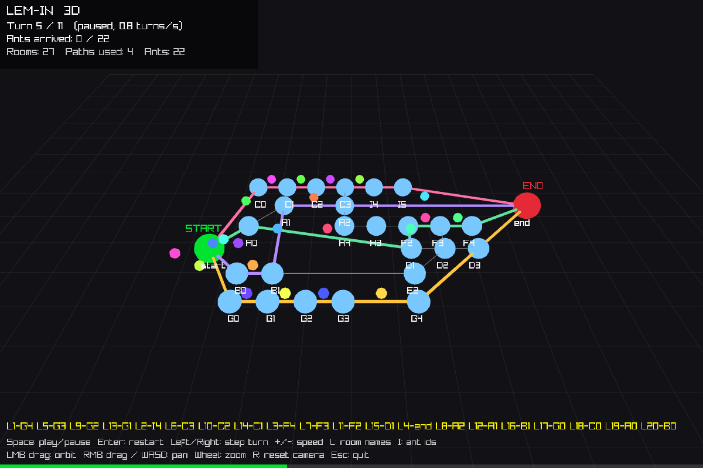
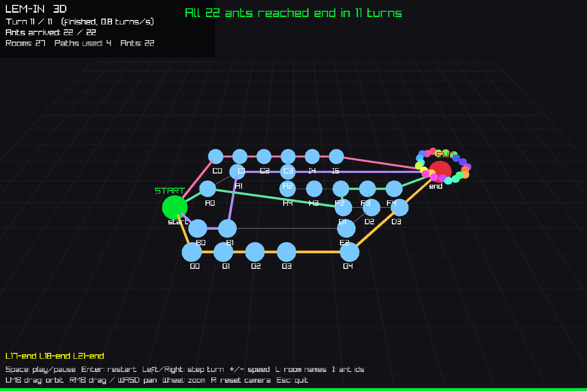
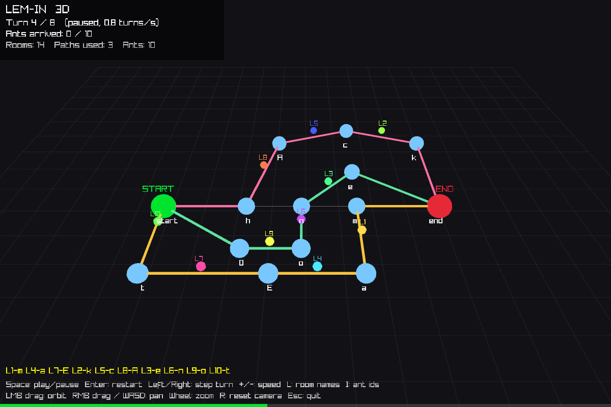
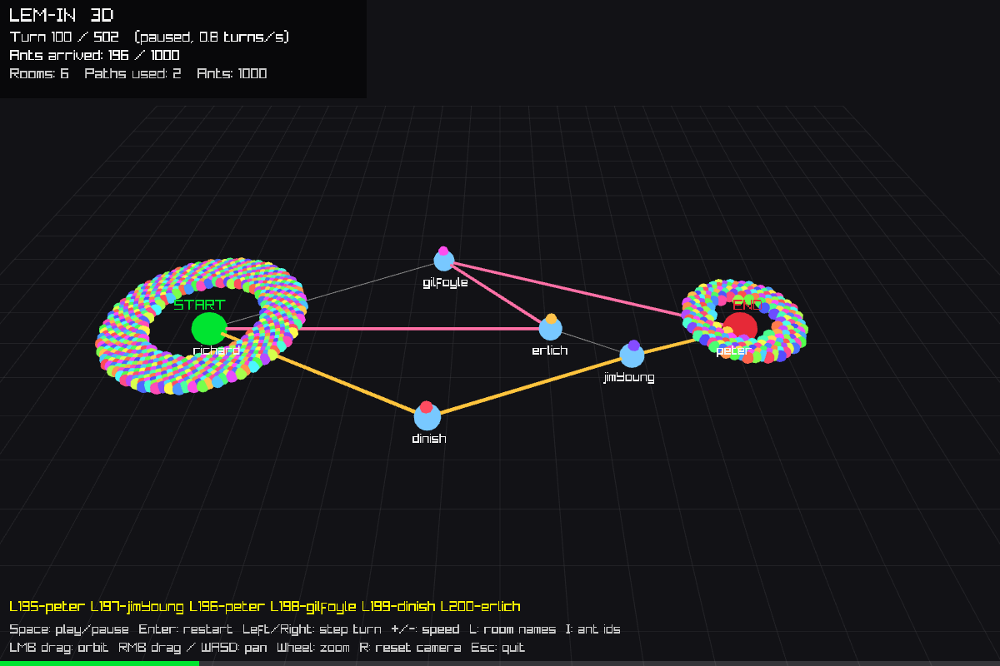
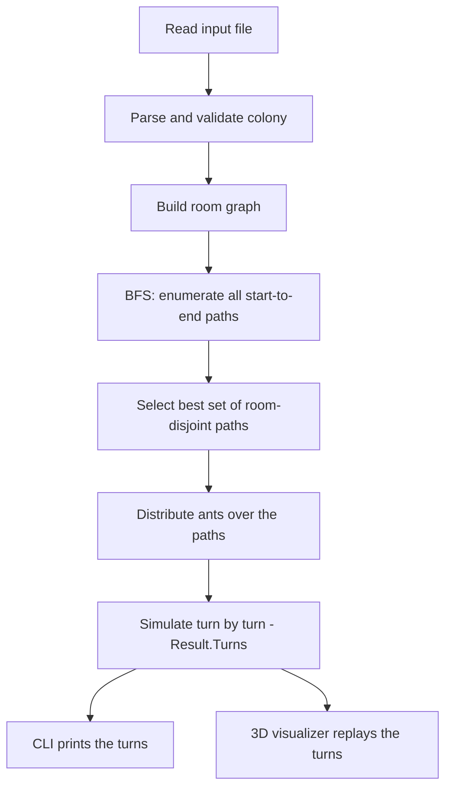

<div align="center">

# LEM-IN
### Ant Colony Pathfinding & 3D Visualization


-blueviolet)


A Go solver for the classic *lem-in* problem, plus a 3D visualizer that replays the solver's real output turn by turn.



</div>

---

## Live Interactive Demo

**[Open Lem-in | 3D Ant Colony Solver →](https://hussainhht.github.io/3d-lim-in-solver/)**


[Mobile preview](docs/images/live-demo-mobile.png) · Real browser captures, not design mockups.

Explore the real Go solver in a browser: edit or upload colony maps, solve with WebAssembly in an isolated Web Worker, and replay verified ant movements in an interactive Three.js observatory. Includes orbit/pan/zoom, route highlighting, room and ant inspection, precise playback and scrubbing, live statistics, exact solver output, responsive controls, and a graphics fallback.

The CLI and original Raylib application are preserved. The web demo lives in `web/`, shares `handles/`, and deploys from **`livedemo`** through GitHub Actions. Visitors install nothing and maps stay on their device.

```bash
cd web
npm ci
npm run wasm
npm run dev
```

For production use `npm run build`; for a local production preview use `npm run preview` and open `/3d-lim-in-solver/`. Development requires Go 1.24.2+ and Node 22.19+. [Architecture, testing, deployment, browser support and limitations](docs/LIVE_DEMO.md).

## Table of Contents

1. [Project Preview](#project-preview)
2. [About the Project](#about-the-project)
3. [Key Features](#key-features)
4. [Technologies Used](#technologies-used)
5. [How Lem-in Works](#how-lem-in-works)
6. [Algorithm Explanation](#algorithm-explanation)
7. [Input File Format](#input-file-format)
8. [Example Output](#example-output)
9. [Installation](#installation)
10. [Running the Program](#running-the-program)
11. [Running the 3D Visualizer](#running-the-3d-visualizer)
12. [Project Architecture](#project-architecture)
13. [Design Decisions and Challenges](#design-decisions-and-challenges)
14. [Testing](#testing)
15. [Troubleshooting](#troubleshooting)
16. [Known Limitations](#known-limitations)
17. [Future Improvements](#future-improvements)
18. [Credits](#credits)

---

## Project Preview

All images below are real captures of the visualizer, produced with the `-screenshot` flag (see [Running the 3D Visualizer](#running-the-3d-visualizer)).

| Mid-run: ants in transit | Finished: all ants at the end room |
|---|---|
|  |  |
| `3D/input.txt` (22 ants, 27 rooms, 4 paths), turn 4.5 of 11 | Same map after turn 11 |

| A different map (`test/example01.txt`) | A large colony (`test/example07.txt`, 1000 ants) |
|---|---|
|  |  |

> The terminal output of the CLI is shown as text in [Example Output](#example-output). No terminal screenshot is included.

---

## About the Project

**Lem-in** is a graph problem. A colony ("ant farm") is a set of **rooms** joined by **tunnels**. Every ant starts in the **start** room and must reach the **end** room. The rules:

- an ant moves through one tunnel per turn;
- a room other than start and end holds at most one ant at a time;
- a tunnel carries at most one ant per turn.

The goal is to get **all ants to the end in as few turns as possible**. Sending every ant down the single shortest path is rarely best: a slightly longer second path lets half of the ants travel in parallel. The solver therefore has to decide *which* paths to use and *how many ants* to send down each.

This project contains:

1. **The solver** (`main.go` + `handles/`), a command-line program that reads a colony file and prints the colony followed by one line per turn.
2. **The 3D visualizer** (`3D/`), which runs the same solver in-process and replays its turns as an animation, so what you see is exactly what the CLI prints.

Rooms keep the `x y` coordinates given in the input file; the visualizer uses them as the floor-plane layout.

---

## Key Features

Every item below was checked against the code or by running it.

- **Strict input parsing and validation**: ant count, `##start`/`##end`, rooms with coordinates, tunnels, comments; malformed maps are rejected (see [Input File Format](#input-file-format)).
- **Path discovery** with a breadth-first enumeration of every simple start-to-end path.
- **Path-set selection**: picks a set of room-disjoint paths that minimises the number of turns (by backtracking over the candidates).
- **Ant allocation** across the chosen paths so that all paths finish at (nearly) the same turn.
- **Turn-by-turn simulation** with a structured result (`Result.Turns`) shared by the CLI and the visualizer.
- **Built-in verifier** (`lemin.Verify`) that re-checks a result against the lem-in rules: legal tunnels, one move per ant per turn, one ant per tunnel per turn, no shared rooms, everyone arrives. It runs in the test-suite and on every visualizer start-up.
- **3D visualizer** (raylib-go): orbit camera, play/pause, restart, step, speed control, per-ant colors, room labels, turn and arrival counters, and a live view of the solver's output line for the turn being animated.
- **Headless check mode** (`-check`) to solve and verify a map without opening a window.

---

## Technologies Used

| Technology | Purpose |
|---|---|
| [Go](https://go.dev/) 1.24 | Solver, parser, simulator, visualizer |
| Breadth-first search + backtracking | Path enumeration and path-set selection (`handles/`) |
| [raylib-go](https://github.com/gen2brain/raylib-go) v0.55.1 | 3D rendering and input |
| [raylib](https://www.raylib.com/) 5.5 (`raylib.dll`) | Native graphics library, loaded at run time via [purego](https://github.com/ebitengine/purego) |
| [GLFW](https://www.glfw.org/) 3.4 (`glfw3.dll`) | Window/OpenGL context; required by `raylib.dll` |
| Go `testing` | Unit tests (`handles/lemin_test.go`) |

On Windows the visualizer is built **without cgo**: raylib-go falls back to purego and loads `raylib.dll` dynamically, so no C compiler is needed.

---

## How Lem-in Works



1. **Read the map.** `main.go` takes one argument, the input file name (it must end in `.txt`).
2. **Parse rooms and tunnels.** `Exportinfo` builds an `Antsfarm`: a `map[string]*Room`, each room holding pointers to its neighbours (`Links`), plus the start and end rooms.
3. **Find candidate routes.** `BFS` enumerates simple paths from start to end.
4. **Select paths.** `findBestPaths` keeps the room-disjoint subset with the lowest estimated turn count.
5. **Allocate ants.** `computeAntDistribution` decides how many ants each selected path receives.
6. **Move ants.** `Simulate` advances every path one room per turn and releases new ants from the start.
7. **Print.** `RunAlgorithm` echoes the input map, then prints one line per turn.
8. **Visualize.** `3D/main.go` calls the same `Simulate`, verifies the result and animates it.

**How the visualizer gets its data:** it does not read the CLI's output and does not simulate anything on its own. `3D/main.go` imports `lemin/handles`, calls `lemin.Simulate(farm)` and receives the same `Result` the CLI prints. The movements of each ant are derived from that result with `Result.Tracks`.

---

## Algorithm Explanation

### Graph representation

Rooms are nodes; tunnels are undirected edges stored as adjacency lists of `*Room` pointers.

```go
type Room struct {
	Name    string
	Links   []*Room
	Ant     *Ant
	X, Y    int
	Visited bool
}
```

A `Path` holds the rooms an ant walks through. **It does not include the start room**; the last element is the end room, so `len(path.Rooms)` is exactly the number of tunnels the path crosses.

### 1. Route discovery

`BFS` keeps a queue of *partial paths* (not just rooms). It starts from every neighbour of the start room, extends each path with every neighbour that is not already on it (and is not the start), and records a path whenever its last room is the end room:

```go
for _, neighbor := range lastRoom.Links {
	// Skip rooms already in path OR start room
	if !roomInPath(path, neighbor) && neighbor != start {
		newPath := append([]*Room{}, path...) // copy current path
		newPath = append(newPath, neighbor)
		queue = append(queue, newPath)
	}
}
```

This is **exhaustive**: it returns *all* simple paths, not only shortest ones. That makes the later selection simple, but the number of simple paths can grow exponentially (see [Known Limitations](#known-limitations)).

### 2. Choosing the paths to use

Two paths that share a room cannot be used together (an ant on each could collide). `pathsOverlap` compares every room except the end room. `findBestCombination` then explores include/exclude decisions for every path with backtracking, skipping any inclusion that overlaps an already-chosen path, and keeps the combination with the fewest estimated rounds.

The estimate (`numberOfRounds`) binary-searches the smallest `T` such that the chosen paths can deliver all ants:

```go
// Check if T rounds can deliver all ants across the selected paths
canDeliver := func(T int) bool {
	sum := 0
	for _, b := range base {
		c := T - b + 1 // contribution of this path
		if c > 0 {
			sum += c
			...
```

The comparison is therefore between *sets*, not just path counts: a set of two long paths can lose against one short path when there are few ants, and win when there are many.

### 3. Distributing the ants

`computeAntDistribution` assigns ants one at a time to the path with the smallest `len(path.Rooms) + antsAlreadyAssigned`:

```go
for remaining > 0 {
	minTurns := int(^uint(0) >> 1)
	var bestPath *Path
	for _, path := range paths {
		turns := len(path.Rooms) + dist[path.String()]
		if turns < minTurns {
			minTurns = turns
			bestPath = path
		}
	}
	dist[bestPath.String()]++
	remaining--
}
```

This equalises finishing times: the last ant on a path with `k` ants and `L` tunnels arrives at turn `L + k - 1`.

### 4. Scheduling and collision avoidance

`Simulate` runs one loop iteration per turn until every ant has arrived:

```go
for antFarm.DoneAnts < antFarm.TotalAnts {
	resetVisited(paths)
	for _, path := range paths { // move ants in paths forward
		UpdatePath(antFarm, path)
	}
	AssignAntsToPath(antFarm, paths, dist)
	result.Turns = append(result.Turns, antFarm.flushTurn())
}
```

- `UpdatePath` moves every ant on a path one room forward, **front ant first**, so the room ahead has always been vacated.
- `AssignAntsToPath` then releases **at most one new ant per path** into the path's first room, as long as that path still has ants left in its quota.
- Every movement is recorded (`antFarm.record`) as an `L<id>-<room>` entry of the current turn.

Collisions cannot occur by construction: the chosen paths share no room, ants on one path move in lock-step one tunnel at a time, and only one ant enters a path per turn. `Ant.Move` additionally contains a defensive occupancy check for the next room. The independent `Verify` function confirms the rules on every run of the tests and of the visualizer.

### 5. Counting turns

A turn is one iteration of the loop above; a turn's movements are the `L<id>-<room>` tokens of one output line. The total is `len(Result.Turns)`.

### Worked example

`input.txt` has 4 ants and a single corridor `0 → 2 → 3 → 1` (start `0`, end `1`). The only path is `[2 3 1]`, all 4 ants go through it, and the last ant arrives at turn `3 + 4 - 1 = 6`, which is what the program prints.

### Complexity and optimality

- **Route discovery and selection are exponential in the worst case**: all simple paths are enumerated, and the backtracking visits up to `2^n` subsets of `n` paths. Measured on the development machine: a 3×3 grid colony (11 rooms) solves in 0.14 s, a 4×4 grid (18 rooms) takes about 53 s, and a 5×5 grid did not finish within 120 s.
- **Simulation is linear** in the number of movements (`ants × path length`).
- **Optimality is not proven.** The selection step compares sets with an estimate and only considers room-disjoint paths. In testing, the solver matched the reference turn counts shipped in `result/`, and on 277 random small maps (≤ 9 rooms, ≤ 14 simple paths) its turn count equalled a brute-force optimum computed over all room-disjoint path sets. That is evidence, not a proof, and the brute-force script is not part of the repository.

---

## Input File Format

```text
4
##start
0 0 3
2 2 5
3 4 0
##end
1 8 3
0-2
2-3
3-1
```

| Part | Meaning |
|---|---|
| First line, `4` | Number of ants. Must be a positive integer, at most 1,000,000. Comments before it are allowed. |
| `##start` | The **next room line** is the start room. Only one allowed. |
| `##end` | The **next room line** is the end room. Only one allowed. |
| `name x y` | A room: unique name (must not start with `L`, must not contain `-`) and integer coordinates (unique per room). |
| `a-b` | A tunnel between two *already defined* rooms. No self-loops, no duplicates. |
| `# ...` | Comment. Other `##...` lines are ignored. |

Rules enforced by the parser: rooms must be declared before any tunnel; start and end must both exist; a `##start`/`##end` must be followed by a room, not a tunnel; the file name must end in `.txt`. Blank lines are skipped, and CRLF files work.

---

## Example Output

```console
$ go run . input.txt
4
##start
0 0 3
2 2 5
3 4 0
##end
1 8 3
0-2
2-3
3-1

L1-2
L1-3 L2-2
L1-1 L2-3 L3-2
L2-1 L3-3 L4-2
L3-1 L4-3
L4-1
```

The program first echoes the input map, then a blank line, then the simulation. Each line is **one turn**; each `L<ant>-<room>` token means *ant number `<ant>` moves into `<room>` this turn*. Here ant 1 enters room `2` in turn 1, room `3` in turn 2 and the end room `1` in turn 3, while ant 2 follows one step behind. The last ant arrives in turn 6. (Real output has a trailing space after each token; it is omitted above.)

A larger run, `go run . test/example01.txt` (10 ants, 14 rooms, 3 paths), finishes in 8 turns:

```text
L1-t L2-h L3-0
L1-E L2-A L3-o L4-t L5-h L6-0
L1-a L4-E L2-c L5-A L3-n L6-o L7-t L8-h L9-0
L1-m L4-a L7-E L2-k L5-c L8-A L3-e L6-n L9-o L10-t
L1-end L4-m L7-a L10-E L2-end L5-k L8-c L3-end L6-e L9-n
L4-end L7-m L10-a L5-end L8-k L6-end L9-e
L7-end L10-m L8-end L9-end
L10-end
```

**Invalid input** prints the reason on stderr and `ERROR: invalid data format` on stdout, with exit status 1:

```console
$ go run . test/badexample00.txt
Invalid ants: 0
ERROR: invalid data format
```

---

## Installation

**Requirements**

- [Go](https://go.dev/dl/) **1.24.2 or newer** (the version in `go.mod`).
- For the 3D visualizer on Windows: nothing else; `raylib.dll` and `glfw3.dll` are in the repository root.

```bash
git clone https://learn.reboot01.com/git/hussainali7/lem-in.git
cd lem-in
go mod download
go build ./...
```

> **If `go build ./...` fails with** `cgo: C compiler ... not found` **on Windows**, set `CGO_ENABLED=0` (PowerShell: `$env:CGO_ENABLED = "0"`; Git Bash: `export CGO_ENABLED=0`). The solver itself needs no cgo. Only the visualizer package does, and the Windows visualizer is designed to run without it. See [Troubleshooting](#troubleshooting).

---

## Running the Program

The solver takes **exactly one argument**: the path of a `.txt` colony file. (It does not read standard input.)

```bash
# run directly
go run . input.txt
go run . test/example05.txt

# build an executable
go build -o lem-in .         # Linux/macOS
go build -o lem-in.exe .     # Windows
./lem-in test/example02.txt  # .\lem-in.exe test\example02.txt on Windows

# the bundled comparison script (runs example00-05 and prints the expected result next to each)
bash run_tests.sh
```

> Running the solver also writes the echoed input map to `result.txt` in the current directory (existing behaviour of `main.go`).

Run the tests:

```bash
go test ./...            # add CGO_ENABLED=0 on Windows without a C compiler
go test -v ./handles
```

---

## Running the 3D Visualizer

### Quick start (Windows, PowerShell)

```powershell
.\run-3d.ps1                              # visualize input.txt
.\run-3d.ps1 -Map test\example01.txt      # pick a map
.\run-3d.ps1 -Map test\example06.txt -Speed 3
.\run-3d.ps1 -Check                       # solve + verify only, no window
```

The script builds `lem-in-3d.exe` (with `CGO_ENABLED=0`), checks that `raylib.dll` and `glfw3.dll` are present and starts the visualizer from the repository root.

Without the script, from the repository root:

```bash
CGO_ENABLED=0 go run ./3D -input test/example01.txt     # PowerShell: $env:CGO_ENABLED="0"; go run ./3D -input test\example01.txt
```

The visualizer must be started **from the repository root** (or with the DLLs next to the executable), because Windows looks for `raylib.dll` and `glfw3.dll` there.

### Command-line flags

| Flag | Default | Meaning |
|---|---|---|
| `-input` | `input.txt` | Colony file to load (must end in `.txt`) |
| `-speed` | `0.8` | Playback speed in turns per second |
| `-scale` | `1.6` | Spread of the room layout (multiplies input coordinates) |
| `-check` | off | Solve and verify, print a summary to stderr, exit; no window, no GPU needed |
| `-screenshot FILE` | none | Development aid: render, save a PNG and exit |
| `-shot-turn N` | last turn | Turn (may be fractional) to capture with `-screenshot` |

### Controls

All controls below are implemented in `3D/main.go`.

| Input | Action |
|---|---|
| `Space` | Play / pause (restarts if finished) |
| `Enter` | Restart from turn 0 and play |
| `Right` / `Left` | Step one turn forward / back (pauses) |
| `+` / `-` (also numpad) | Increase / decrease playback speed (0.1 – 30 turns/s) |
| `L` | Toggle room names |
| `I` | Toggle ant ID labels (only drawn for colonies of at most 40 ants; on by default for at most 12) |
| Left mouse drag | Orbit the camera |
| Right mouse drag, `W` `A` `S` `D` | Pan the camera over the floor plane |
| Mouse wheel | Zoom |
| `R` | Reset the camera |
| `Esc` | Quit |

### What you are looking at

| Element | Meaning |
|---|---|
| Large green sphere, `START` | Start room |
| Large red sphere, `END` | End room |
| Small blue spheres | Other rooms (names shown below them) |
| Thin gray lines | Tunnels |
| Thick colored lines | Tunnels of the paths the solver chose (one color per path) |
| Small colored spheres | Ants; each ant keeps one color derived from its ID |
| Rings of spheres around start / end | Ants still waiting at the start / already arrived at the end |
| HUD, top left | Current turn / total turns, ants arrived, rooms, paths used, ant count |
| Yellow line, bottom | The solver's own output line for the turn being animated |
| Green bar, bottom | Progress through the turns |

Between two integer turns each moving ant is interpolated (smoothstep) from its current room to the next one, so the animation advances exactly one tunnel per ant per turn.

### Requirements and how the DLLs are found

- Windows x64, an OpenGL 3.3-capable GPU/driver.
- `raylib.dll` (raylib 5.5, version-checked by raylib-go at load) and `glfw3.dll` (GLFW 3.4) next to the executable. `raylib.dll` imports `glfw3.dll`; without it Windows reports *"cannot load library raylib.dll: The specified module could not be found."*
- No C compiler, no cgo.

Platform status: the visualizer has been **built and run on Windows 11 (amd64)** only. On Linux/macOS raylib-go compiles raylib through cgo; that path is untested here and the PowerShell launcher is Windows-only.

---

## Project Architecture

```text
lem-in/
├── main.go                 CLI entry point (solver)
├── go.mod / go.sum         Module "lemin" (Go 1.24.2), raylib-go v0.55.1
├── handles/                Solver package ("lemin")
│   ├── models.go           Antsfarm, Room, Ant, Path, Movement, Result
│   ├── exportinfo.go       Input parsing and validation
│   ├── findallpath.go      FindPaths, path-set selection (backtracking), UpdatePath
│   ├── algorithm.go        Simulate, RunAlgorithm, BFS, ant distribution
│   ├── findbistbath.go     AssignAntsToPath (releases ants into paths)
│   ├── verify.go           Verify (rule checker) and Result.Tracks
│   ├── printant.go         DisplayMovement ("L<id>-<room> ")
│   ├── file.go             Echo input / write result.txt
│   ├── moveant.go          Helpers not used by the solver (marked as unused in the source)
│   └── lemin_test.go       Tests
├── 3D/
│   ├── main.go             raylib-go visualizer
│   └── input.txt           Larger demo map (22 ants, 27 rooms)
├── test/                   Input maps (example00-07, badexample00/01)
├── result/                 Reference outputs for the examples (result06/07 are text notes, not outputs)
├── docs/images/            Screenshots used by this README
├── Notes/                  Team study notes (Markdown)
├── run-3d.ps1              Windows launcher for the visualizer
├── run_tests.sh            Runs examples 00-05 and prints the expected result
├── raylib.dll, glfw3.dll   Native libraries for the Windows visualizer
├── input.txt               Default demo map (4 ants)
└── paths.txt, dist.txt, copy.txt, errt.txt, result.txt
                            Scratch/debug output files kept from development
```

| Module | Responsibility |
|---|---|
| `handles/exportinfo.go` | Turns a file into a validated `Antsfarm` |
| `handles/algorithm.go` | Enumerates paths, allocates ants, runs the turn loop |
| `handles/findallpath.go` | Chooses which paths to use |
| `handles/verify.go` | Independent legality check and per-ant movement tracks |
| `3D/main.go` | Layout, camera, animation, HUD; consumes `Result` |

---

## Design Decisions and Challenges

- **Choosing paths, not just short paths.** The best path set depends on the ant count, so sets are compared by estimated total turns rather than by length or number of paths.
- **Avoiding conflicts structurally.** Instead of resolving collisions at run time, only room-disjoint paths are combined and each path releases one ant per turn. That makes movement trivial to schedule and easy to verify.
- **One simulation, two consumers.** The original solver printed while it simulated. The simulation now records structured movements (`Movement`, `Result`) and `RunAlgorithm` prints them; the visualizer consumes the same data. CLI output stayed byte-identical on all eight example maps after this refactor.
- **Judge-friendly output channel.** Diagnostics go to stderr; stdout holds only the map echo, the turns and, on invalid input, `ERROR: invalid data format`.
- **Trustworthy visualization.** The visualizer runs `Verify` on the result before drawing anything, so the animation can only show legal solutions. Ant positions are computed from per-ant tracks (`Result.Tracks`) at an animation time `τ` measured in turns, so pausing, stepping and scrubbing always agree with the solver output.
- **Rendering large colonies.** Ants use low-poly spheres, and ants waiting at the start or sitting at the end are spread in a golden-angle spiral so a 1000-ant colony stays readable.
- **Windows without a C toolchain.** Building with `CGO_ENABLED=0` makes raylib-go load `raylib.dll` through purego. Both `raylib.dll` and its dependency `glfw3.dll` must be present.

---

## Testing

`handles/lemin_test.go` contains five test functions (31 cases):

| Test | What it checks |
|---|---|
| `TestExamples` | Simulates `test/example00-07`, runs `Verify`, and compares the turn count with `result/result00-05` |
| `TestBadInput` | 13 malformed maps (zero/non-numeric ants, missing start or end, duplicate room/coordinates, `L` room name, unknown room, self-loop, duplicate link, room after links, duplicate `##start`, empty file) are rejected |
| `TestSmallMaps` | Direct start-end tunnel, a single ant, a shared bottleneck, two competing routes |
| `TestTracks` | Per-ant tracks reproduce the turn list and end in the end room |
| `TestVerifyRejectsIllegalResults` | The verifier rejects teleporting, unknown rooms/ants, double moves, shared rooms and unfinished ants |

```bash
go test ./...
```

**Verified results (Windows 11, Go 1.24.2, `CGO_ENABLED=0`):** `go build ./...`, `go vet ./...` and `go test ./...` pass; all 31 cases pass. Beyond the Go tests, a separate script replayed the CLI output of 16 maps (`test/example00-07`, `input.txt`, `3D/input.txt` and six edge cases) and found no rule violation.

| Map | Ants | Turns |
|---|---|---|
| example00 | 4 | 6 |
| example01 | 10 | 8 |
| example02 | 20 | 11 |
| example03 | 4 | 6 |
| example04 | 9 | 6 |
| example05 | 9 | 8 |
| example06 | 100 | 52 |
| example07 | 1000 | 502 |

Turn counts for 00-05 equal the reference results in `result/`. The chosen *paths* can differ from the reference on equal-length alternatives (for example `example03`), which is a legitimate alternative solution.

**Not covered by automated tests:** the GUI itself. The visualizer was run and inspected visually (live window and screenshots), and its data layer is exercised through `Verify` on every launch and through `-check`.

---

## Troubleshooting

| Symptom | Cause and fix |
|---|---|
| `cgo: C compiler "…gcc" not found` during `go build ./...` / `go test ./...` | Windows with cgo enabled but no C compiler. Use `CGO_ENABLED=0` (see [Installation](#installation)). The solver never needs cgo; on Windows the visualizer does not either. |
| `panic: cannot load library raylib.dll: The specified module could not be found.` | `raylib.dll` is missing, **or its dependency `glfw3.dll` is missing**, or you started the program from another directory. Keep both DLLs in the repository root and run from there (or use `.\run-3d.ps1`). |
| `raylib.dll` loads but the version check panics | raylib-go v0.55.1 requires raylib **5.5**. Use a matching `raylib.dll`. |
| Window does not open / OpenGL error | The GPU or driver must support OpenGL 3.3. Update the graphics driver. |
| `File name must end with .txt` | The solver and visualizer accept only `.txt` files. `test/badexample01` has no extension and is rejected for that reason. |
| `ERROR: invalid data format` | The map is malformed; the line above it on stderr says why (e.g. `Missing start room`, `Duplicate room name: …`). |
| `No paths found from start to end` | The map is valid but start and end are not connected. Exit status 1. |
| Solver seems to hang on a larger map | Path enumeration is exponential, see [Known Limitations](#known-limitations). |
| `.\run-3d.ps1` blocked by execution policy | Run `powershell -ExecutionPolicy Bypass -File .\run-3d.ps1` or `go run ./3D` as shown above. |

---

## Known Limitations

- **Exponential run time on large or dense colonies.** All simple paths are enumerated and subsets of them are searched. A 4×4 grid colony (18 rooms) took ≈ 53 s; a 5×5 grid did not finish within 120 s. A flow-based approach (e.g. Edmonds–Karp/Suurballe-style disjoint paths) would remove this; it is not implemented.
- **Optimality is empirical, not proven** (see [Complexity and optimality](#complexity-and-optimality)).
- Only **room-disjoint** path sets are considered.
- The CLI always writes `result.txt` in the working directory, and requires the input file name to end in `.txt`.
- The 3D visualizer ships a Windows-only launcher and has only been run on Windows.
- `paths.txt`, `dist.txt`, `copy.txt`, `errt.txt` and `moveant.go` are leftovers from development and are not used by the solver.

---

## Future Improvements

*These are ideas, not implemented features.*

- Replace path enumeration with a max-flow / min-cost-flow based search for disjoint paths to scale to large colonies.
- Add a `run-3d.sh` launcher and verify the visualizer on Linux and macOS.
- Allow reading a colony from standard input as well as from a file.
- Add a screenshot-based or recorded-replay regression test for the visualizer.

---

## Credits

Developed as a [Reboot01](https://learn.reboot01.com) project. Commit authors in the repository history: **hussainali7**, **basayed**, **Bader Al3foo** (also committing as *Bader Alafoo*). The `Notes/` folder contains study notes by `Batool` and `hussain`.

The 3D visualizer uses [raylib](https://www.raylib.com/), [raylib-go](https://github.com/gen2brain/raylib-go) and [GLFW](https://www.glfw.org/) (zlib/libpng license, copyright the GLFW authors). `glfw3.dll` in this repository is the unmodified `lib-static-ucrt` build from the official GLFW 3.4 Windows release (`glfw-3.4.bin.WIN64.zip`, SHA-256 `54efa829400f2a0537f742b2b3bdd74e437bb4f2f048e4b7d3c5557d11a611e6`).

No license file exists in this repository, so no license is declared.
