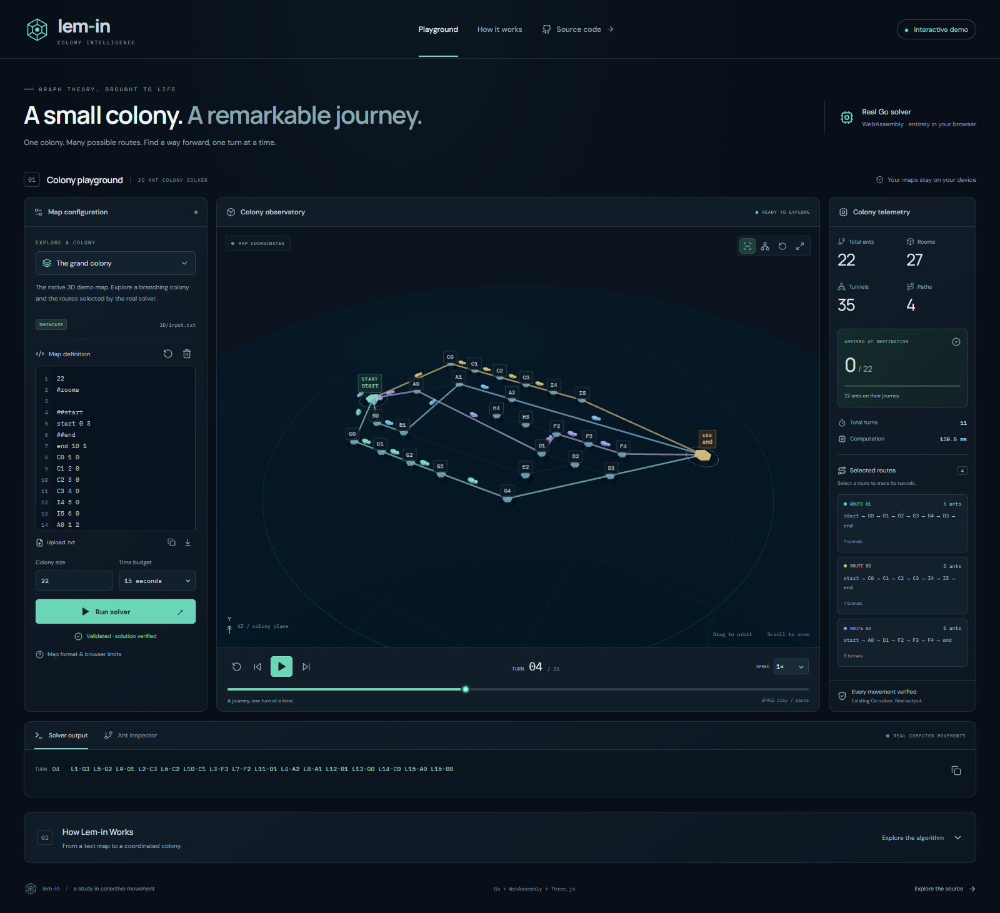

# Live interactive demo

Target: **https://hussainhht.github.io/3d-lim-in-solver/**

The browser application is an additional consumer of the existing Go solver. The original CLI, Raylib application, maps, reference results, native libraries and authorship remain in place. Work and deployment are confined to `livedemo`.



[Mobile WebKit screenshot](images/live-demo-mobile.png). Both screenshots are real production-preview browser captures.

## Use the playground

The showcase loads and solves `3D/input.txt` on arrival. Select an example and press **Run solver**, upload a `.txt` file, or paste/edit a map. Editing or changing maps clears the old result immediately. Colony size updates the real ant-count line in the editor; the Go parser is the authority when solving.

Drag the scene to orbit, right-drag to pan, and scroll/pinch to zoom. The toolbar toggles labels, switches between original coordinate and radial layouts, and resets/fits the camera. Radial layout changes only presentation. Select a room label for coordinates, degree and occupancy, or a route card to highlight its tunnels.

Use play/pause, previous/next turn, restart, the timeline and speed controls to replay the solution. Space toggles playback and arrow keys step when focus is outside form controls. Turn 0 has all ants at start. The output inspector shows the exact CLI line for the **last completed turn**, including its original ordering and trailing spaces. The ant inspector exposes stable IDs, assigned routes, completed room positions, next movements and arrival status.

## Architecture

```text
Repository .txt maps / uploaded or edited text
  → module Web Worker
    → matching Go wasm_exec.js + solver.wasm
      → handles.ParseMap(io.Reader)
      → browser limits + reachability check
      → existing Simulate
        → BFS: enumerate simple paths
        → findBestPaths: backtrack over compatible room-disjoint combinations
        → sort selected paths by descending length (existing behavior)
        → computeAntDistribution: length + current allocation
        → UpdatePath, then AssignAntsToPath, recording each movement
      → existing Verify
      → pointer-free JSON result
  → deterministic tracks derived only from Result.Turns
  → React UI + React Three Fiber / Three.js scene
```

No server, external solver API, Raylib DLL or local installation is required for visitors. Map text is never uploaded. Fonts, map text, JavaScript, styles, icons, Go runtime and WASM are shipped in the static build. External links lead to the repository; the application itself makes no third-party runtime requests.

`handles/exportinfo.go` shares its parser through `ParseMap(io.Reader)`. `Exportinfo` retains the CLI's `.txt` file wrapper and reports returned errors. Parser errors now have line numbers. Valid CLI stdout is unchanged. `handles/browser.go` adapts existing data and calls `Simulate` and `Verify`; it does not implement another pathfinder. The native application continues calling the same APIs.

Every run gets a fresh worker and Go runtime. Cancellation, timeout, edits and component teardown terminate that worker. A new run creates a clean worker, so cancelled computations cannot post stale results. A Blob module import loads the unmodified official Go runtime inside the module worker. `build-wasm.mjs` copies the runtime from the **same installed Go toolchain** that produces the WASM binary ([Go guidance](https://go.dev/wiki/WebAssembly)).

Tracks group actual movements by ant ID. At time `t`, `floor(t)` determines completed moves. Only a movement recorded for the next turn is interpolated with smoothstep. Scrubbing recomputes positions from tracks; it never depends on playback history. Arrival counts use completed end-room movements. Endpoint offsets spread parked ants visually, while their logical positions remain start/end.

Ant body parts and legs use instanced meshes, with route colors and low-poly geometry. Rendering caps pixel ratio at 1.5 and avoids heavy postprocessing. A graphics error boundary provides an SVG graph using the same tracks when WebGL is unavailable. The text and ant inspectors remain available. Reduced-motion mode advances playback at integer turns, suppresses decorative animation and removes smooth scrolling.

## Local development

Requirements: Go **1.24.2+** and Node **22.19+**, with npm. These are developer requirements only.

```bash
cd web
npm ci
npm run wasm
npm run dev
```

Open the printed local URL at `/3d-lim-in-solver/`. Re-run `npm run wasm` after modifying Go code. The build script sets `GOOS=js GOARCH=wasm CGO_ENABLED=0` for its child process only; it does not alter your shell's native Go target.

Production build and preview:

```bash
cd web
npm run build
npm run preview -- --port 4173
```

Open **http://127.0.0.1:4173/3d-lim-in-solver/**. `npm run build` compiles WASM, copies its runtime, type-checks TypeScript and builds Vite. Generated WASM/runtime, `node_modules`, `dist`, test traces and temporary files are ignored. Production hosts only `web/dist/`.

## Validation

Native regression on Windows without a C compiler:

```powershell
$env:CGO_ENABLED = '0'
go build ./...
go vet ./...
go test ./...
go run ./3D -input test/example01.txt -check
go run ./3D -input 3D/input.txt -check
go test ./handles -run '^$' -bench BenchmarkBrowserExamples -benchtime=1x -benchmem
```

The original examples and reference turn counts are tested without modifying `result/`. The references contain alternate legal ordering/path choices, and `result02.txt` includes a malformed token, so reference files are used for turn counts rather than fabricated byte equality. `TestOriginalCLIStdout` also compares SHA-256 digests captured from the pre-refactor CLI on `input.txt`, `3D/input.txt` and all eight examples, including map echoes, ordering and whitespace.

Browser engine and production tests:

```bash
cd web
npm run build
npm test
npx playwright install chromium firefox webkit
npm run test:e2e
```

Local verification on 2026-10-28: native build/vet/tests passed with cgo disabled; both native `-check` commands passed; all 11 WASM/CLI engine tests and all 16 Playwright tests passed across desktop Chromium, Firefox, mobile Chromium and mobile WebKit. Two strengthened production smoke checks also passed after the label-cleanup fix. Desktop/mobile screenshots were inspected, mobile native-select contrast was corrected, and camera framing was adjusted. The default local cgo setting initially failed because the configured C compiler is absent; the documented purego configuration passed. Physical phones and the Microsoft Edge executable were not tested locally.

On Linux, install browsers with `npx playwright install --with-deps chromium firefox webkit`. The engine suite compares actual WASM results against a freshly compiled native Go oracle and exact CLI turn lines on ten maps. It also checks every ant at integer and intermediate times, invalid-map rejection and recovery. The Go suite adds assignment parity, disconnected-map errors, limits, and dense-map budget rejection. E2E tests use the real production build at its repository subpath, including WASM initialization, real solving, editing/upload/download, invalid input, playback, scrub restoration, route/camera controls, timeout, cancellation, recovery, reduced motion, fallback graphics and mobile overflow. Delayed network responses make the cancellation/timeout lifecycle test deterministic; normal solving tests use the real WASM without mocks.

## Browser safeguards and limitations

The original algorithm enumerates **all simple paths** and backtracks over compatible combinations. It has exponential worst-case cost. The UI makes no claim of proven global optimality; passing legality/reference tests is measured evidence.

Browser-only limits:

| Resource | Limit |
|---|---:|
| Input text / uploaded file | 128 KiB |
| Ants | 1,000 |
| Rooms / tunnels | 80 / 160 |
| Queued partial paths | 50,000 |
| Enumerated candidate paths | 256 |
| Backtracking calls | 2,000,000 |
| Worker wall-clock budget, including initialization | 5, 15 (default), or 30 seconds |

These are rejection limits, never a pruning or approximation strategy. Native CLI and Raylib callers have no new search budget. Dense maps can be rejected even when room/tunnel counts are small. UI timeout and cancellation terminate the worker externally, including while synchronous Go code is executing. Very slow devices or networks may need the 30-second budget. Increasing that budget does not remove memory/search caps.

Single-iteration native adapter measurements on this development machine (Windows, AMD Ryzen 7 5700U, Go 1.24.2; not browser timings or scaling guarantees):

| Map | Approx. duration | Allocated bytes |
|---|---:|---:|
| example00 | 0.29 ms | 14,240 |
| example05 | 21.1 ms | 4,404,632 |
| example07, 1,000 ants | 19.6 ms | 1,423,616 |
| 3D showcase | 19.6 ms | 4,452,200 |

Room layout normalizes the supplied integer coordinates to fit the scene. Maps with near-coincident coordinates or crossing tunnels can be clearer in the radial layout. Extreme integer coordinates beyond JavaScript's exact numeric range can lose display precision. The browser preserves graph connectivity and recorded movement regardless of layout. The native code's integer parsing behavior is retained.

Current Chrome/Edge, Firefox and Safari are the intended browsers. WebAssembly, module workers, ES2022 and WebGL2 are needed for the full experience; SVG and text playback cover unavailable graphics. Mobile touch controls support orbit, pan and zoom through OrbitControls. Automated desktop/mobile browser-engine coverage does not replace testing on physical iOS/Android devices. Self-hosted fonts have their upstream Fontsource/OFL package licenses; this does not add a project license.

## GitHub Pages deployment

Workflow: `.github/workflows/deploy-livedemo.yml`.

1. In **hussainhht/3d-lim-in-solver → Settings → Pages → Build and deployment → Source**, choose **GitHub Actions** if it is not already configured.
2. Ensure the `github-pages` environment permits deployments from **livedemo**. If a branch restriction is enabled, add `livedemo`; do not change `main`.
3. Push to the GitHub remote explicitly: `git push github livedemo:livedemo`.
4. Inspect **Actions → Deploy livedemo to GitHub Pages**. For manual dispatch, choose `livedemo` in the branch selector if GitHub exposes the workflow there. GitHub may require a workflow on the default branch to expose the manual button; automatic push deployment does not have that requirement. Do not merge to `main` just to add that button.

Only push events on `livedemo` or manual runs explicitly on `livedemo` can run the jobs. Checkouts use the event's exact commit. A Windows job builds/vets/tests the complete native repository with cgo disabled. An Ubuntu job builds the actual WASM/frontend, runs engine parity and Playwright tests, then uploads `web/dist/` using official Pages actions. The deployment job has `pages: write` and `id-token: write`; repository contents remain read-only. Browser evidence is retained as an Actions artifact.

Vite's base is **`/3d-lim-in-solver/`**, following the [Vite repository-site guidance](https://vite.dev/guide/static-deploy.html#github-pages). Runtime fetches use `import.meta.env.BASE_URL`; Vite handles bundled chunks, maps and font URLs. There is no client-side pathname router, so refreshing the base URL or hash anchors needs no server rewrite. No build/push targets the Gitea remote or modifies `main`.
